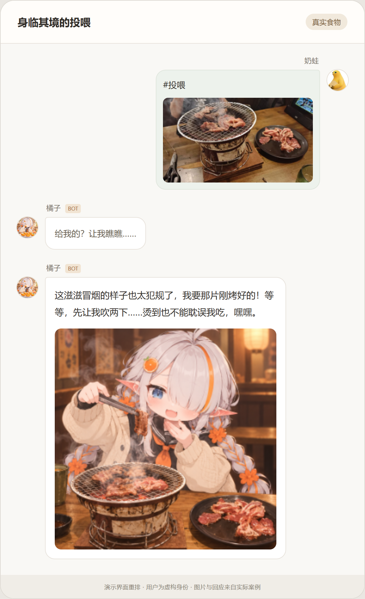

<div align="center">
  
  <h1>🍽️ 身临其境的投喂</h1>
  <p>把今天吃的东西分享给你的角色。</p>
  <p>
    
    
    <a href="https://github.com/Mikakei/astrbot_plugin_feeding/blob/main/LICENSE"></a>
    
    
  </p>
</div>

一款 AstrBot AI 投喂生图插件。发送或引用食物图片，插件会识别内容，沿用当前会话人格生成点评，再结合你上传的角色参考图绘制进食画面，**点评与图片一同回复**。

角色外观、点评风格和固定回复均可在独立插件页面定制。开启抢饭后，另一位自定义角色有概率接走本次食物，以自己的口吻点评并生成进食图。

## 🖼️ 效果展示

发送食物图片，角色结合本次投喂作出回应，并生成进食画面。

<table>
<tr>
<td width="50%"></td>
<td width="50%"></td>
</tr>
</table>

图片取自实际案例。示例使用自定义角色与人格，实际效果随你的设置变化。

**[查看更多案例：表情包食物识别与非食物回应](https://github.com/Mikakei/astrbot_plugin_feeding/blob/main/docs/EXAMPLES.md)**

## ✨ 功能

- **根据本次投喂生图**：结合食物、角色参考图及点评情绪生成画面。
- **沿用会话人格**：读取触发会话当前生效的人格，不修改原人格设置。
- **自定义角色**：上传1张主参考图，可选再上传1张辅助图；画风和人物比例以主图为准。
- **独立定制页面**：大文本区编辑角色提示词、点评风格和固定回复。
- **多角色抢饭**：添加不同角色，自定义参考图与人格，按平均分配或自定义概率随机出场。
- **抢饭彩蛋提醒**：每个角色可设置专属提醒，等成图完成后再揭晓，不提前打断等待。
- **群与个人每日额度**：默认每群30次、每位用户在每群6次，管理员豁免；支持账号黑名单。
- **内容分类**：正常食物进入生图；危险或恶意投喂拒绝，无法确认的内容追问。
- **串行处理与去重**：群聊共用处理队列，减少并发压力和重复请求。

## 📦 安装前准备

- **AstrBot ≥ 4.28.1**。
- **消息适配器**：目前实测 OneBot v11（`aiocqhttp`）。
- **识图提供商**：支持图片输入的聊天模型。
- **生图 API**：需要可用的图片编辑模型接口，用于生成角色进食图。可以复用 AstrBot 已配置提供商的地址与密钥，前提是该服务支持所选生图模型及多图编辑；无需另外部署绘图程序。
- **角色参考图**：1张主图，可选1张辅助图。绘图请求还会附带本次食物图，因此服务需接收2或3张图片。

可以先安装插件，再配置模型。未配置生图 API 时，插件可以加载和设置，但无法完成投喂图文回复；当前不提供仅文字点评模式。接口需兼容 OpenAI `POST /v1/images/edits` 的 `image[]` 多图输入。

## 🛠️ 安装插件

以下方式任选一种即可，技术包名为 `astrbot_plugin_feeding`。先确保 AstrBot 能正常启动并回复消息，再安装本插件。

### 通过仓库链接安装

1. 复制仓库地址：`https://github.com/Mikakei/astrbot_plugin_feeding`。
2. 打开 AstrBot 管理面板的 **插件** 页面，找到安装插件入口，选择通过链接安装（不同版本的按钮名称可能略有不同）。
3. 粘贴仓库地址，等待下载及依赖安装完成。
4. 在已安装列表中确认出现 **身临其境的投喂**，并保持启用。

### 下载 ZIP 后导入

适合自己的电脑可以访问 GitHub，但 AstrBot 所在机器下载仓库不方便的情况。

1. 在本仓库选择 **Code → Download ZIP**，或下载发布版本提供的插件 ZIP 包。
2. 打开 AstrBot 管理面板的 **插件** 页面，找到 **导入压缩包** 入口。
3. 上传 ZIP，等待安装完成，确认插件已启用。

ZIP 导入省去了 AstrBot 下载仓库的步骤；安装 Python 依赖和调用模型仍需相应网络连接。

<details>
<summary>手动放入插件目录（适合本地部署或 Docker / NAS）</summary>

找到当前 AstrBot 实例实际使用的 `data/plugins` 目录，将下载的源码解压到其中，并将插件文件夹命名为 `astrbot_plugin_feeding`。目录结构应为：

```text
data/
└── plugins/
    └── astrbot_plugin_feeding/
        ├── main.py
        ├── metadata.yaml
        ├── requirements.txt
        ├── _conf_schema.json
        ├── pages/
        └── …其余插件文件
```

保留完整源码；不要多套一层下载压缩包的目录。确认 `main.py` 直接位于 `data/plugins/astrbot_plugin_feeding/` 下。

- **本地部署**：使用该 AstrBot 实例的数据目录；自定义了数据位置时，以实际位置为准。
- **Docker / NAS**：在容器配置里查看 AstrBot 数据目录对应的宿主机挂载位置，将插件放入这个数据目录下的 `plugins`。不要把宿主机路径直接当成容器内路径。
- **依赖**：若加载日志提示缺少依赖，在运行 AstrBot 的同一个 Python 环境中安装插件的 `requirements.txt`。对于 Docker，应在容器使用的环境中处理，不能只安装到宿主机 Python。

在已进入 AstrBot 根目录、且 `python` 指向 AstrBot 所用环境时，可以执行：

```sh
python -m pip install -r data/plugins/astrbot_plugin_feeding/requirements.txt
```

完成后重启 AstrBot，在插件列表和日志中确认加载成功。若使用带环境管理的部署方式，应使用其对应的依赖安装方法。

</details>

### 安装后验证

继续完成下方的服务配置，并到 **插件页面 → 身临其境的投喂** 上传主参考图、保存。然后由 AstrBot 管理员发送 `#投喂` 并附上一张食物图，检查是否收到接收提示和最终图文回复。前缀以你的 AstrBot 设置为准。

升级前备份插件配置和角色参考图；手动升级只替换插件源码，保留 `data/config/astrbot_plugin_feeding_config.json` 与 `data/plugin_data/astrbot_plugin_feeding/`。

## 🚀 如何配置

### 1. 选择服务

打开 **插件 → 身临其境的投喂 → 配置**：

1. 在“绘图连接提供商”中选择 AstrBot 已配置的提供商，复用其完整地址与密钥。
2. 选择“生图模型”。插件会从该 API 获取模型列表并筛选候选；列表并不是兼容性验证结果。
3. 选择“食物识别提供商”，或留空跟随当前会话的聊天提供商。
4. 保存配置。初次使用默认仅允许管理员投喂，验证完成后可关闭 `admin_only`。

尺寸、质量默认请求 `512x512`、`low`，**不保证每个模型都支持这些值，也不保证上游按该尺寸返回图片**。按自己的服务要求设置即可。

### 2. 设置角色与回复

打开左侧 **插件页面 → 身临其境的投喂**：

| 配置项 | 如何填写 |
| --- | --- |
| 主参考图 | 必填1张，清晰展示角色外观，作为画风、服装和人物比例的主要依据 |
| 辅助参考图 | 可选1张，用于补充主图未展示的细节 |
| 角色补充提示词 | 可选，补充希望保留的角色特征或绘图要求 |
| 点评风格 | 可选，调整表达习惯与篇幅；留空遵循当前会话人格 |
| 固定回复 | 自定义接收、排队、冷却及点评为空时的兜底文案 |

上传或修改后点击 **“保存修改”**。设置用于后续新投喂，不需要重载插件。参考图每张不超过10MB、2000万像素，建议使用 PNG、JPEG 或 WebP。

### 3. 发起投喂

发送食物图片并附上：

```text
#投喂
```

也可以回复一条食物图片发送命令，或补充本次情境：

```text
#投喂 今天自己做的咖喱饭
```

管理员可用 `#投喂状态` 查看服务配置和近24小时任务统计。命令前缀跟随 AstrBot，文档以 `#` 为例。多图消息只取第一张，当前消息图片优先于引用图片。

## 🐟 多角色抢饭

偶尔让另一位角色半路接走食物，带来不同的点评和进食画面。**角色可自行设置，不限定人物；默认追加大肥鱼作为抢饭彩蛋角色。** 每次投喂仍只生成一张图。

默认彩蛋角色：大肥鱼是默认追加的抢饭角色，但是可以自行在设置里删除或者修改。其参考图、人格和外观补充均可编辑；删除后不会在重启或升级时自动恢复。

### 添加抢饭角色

1. 打开 **插件页面 → 身临其境的投喂 → 角色与回复定制 → 抢饭角色**，点击“添加抢饭角色”。
2. 填写角色名称和独立人格，上传1张主参考图；按需添加1张辅助参考图及外观补充。
3. 打开“启用此角色”和“参与随机出场”，选择概率分配方式。
4. 打开“启用随机抢饭”，检查页面中的出场概率预览，点击 **“保存修改”**。

支持添加、复制、停用和删除，最多30个角色。角色名称不能重复或包含空格。主角色继续沿用 AstrBot 当前会话人格，抢饭角色使用各自的人格，不改动 Bot 的普通聊天人格。

### 概率怎么填？

不想计算，选 **平均分配**；想让某个角色更常出现，选 **自定义分配**。

| 分配方式 | 你需要填写 | 例子 |
| --- | --- | --- |
| 平均分配（推荐） | 一个抢饭总概率 | 总概率30%，三个参与角色各10%，原角色70% |
| 自定义分配 | 每个角色在全部正常投喂中的出场概率 | 角色A填15%、B填10%、C填5%，原角色70% |

页面中的 **“每次正常投喂，谁会出场？”** 会自动显示最终结果。自定义概率合计不能超过100%，剩余概率归原角色，不需要填写“权重”或自行换算。

- 平均分配时，增减参与角色会重新平分，总抢饭概率不变。
- 自定义分配时，新角色默认0%；停用角色释放的概率归还原角色，其他角色不变。
- 关闭“参与随机出场”，或把自定义概率设为0%，仍可由管理员指定测试。
- 停用或未配置完整的角色不参与随机。没有可参与角色时，普通投喂使用原角色。
- **每次独立随机**，可能连续出现同一角色，不保证每100次恰好出现对应次数。

随机抢饭默认关闭；平均分配的总概率默认15%。开关和概率也可在插件常规配置中调整。更多边界与切换规则见[概率说明](https://github.com/Mikakei/astrbot_plugin_feeding/blob/main/docs/MULTI_CHARACTER_PLAN.md)。

### 抢饭提醒什么时候发？

每个角色都有可编辑的 **“抢饭提醒”**，默认是：

> 刚递过去，就被半路接走了……

**等图片生成完成后，连续发送两条消息：**

1. 该角色的抢饭提醒。
2. 该角色的投喂点评和生成图片。

提醒不会在排队或生图时提前发送。留空则不发提醒；非食物、恶意投喂被拒绝或生图失败时也不会发送。正常的接收和排队提示仍沿用原设置。

### 管理员指定角色测试

同条附带食物图片，或回复一条食物图片发送：

```text
#投喂角色A
#投喂角色A 这份是给你的，慢慢吃
```

管理员指定不受随机开关和概率影响，但角色必须已启用且配置完整，仍遵循黑名单、冷却、队列及食物检查。每次仍只占用一次任务，抢饭不额外扣额度；管理员的每日额度豁免继续生效。

所有角色统一使用“投喂＋角色名”，例如 `#投喂大肥鱼`、`#投喂千小妹`，保存角色后即可使用。`#投喂角色 角色名` 的写法仍兼容。名称“角色”和“状态”为指令保留字，请勿使用。命令前缀跟随 AstrBot 设置。

## 🎨 模型推荐与等待时间

结合个人使用效果，推荐尝试 **image2.5**。当前实例使用的模型 ID 为 `gpt-image-2.5-flare`，具体名称以服务提供商为准。

**按个人使用情况，投喂后平均等待约1分半。** 点评和图片会一起回复，实际等待时间随模型服务和排队情况变化。

服务需要支持多图 `Images edits`，模型出现在列表中不代表已验证兼容。

## 🚦 权限与队列

| 项目 | 默认行为 |
| --- | --- |
| 使用权限 | 先遵循 AstrBot 原生权限流程，再应用插件 `admin_only` 限制 |
| 每群每日额度 | 默认30次，可配置，0为不限；各群独立，北京时间零点重置，管理员不占额度 |
| 每人每日额度 | 每个群内分别计算，为群上限的20%，向下取整且至少1次；默认每人6次，管理员豁免 |
| 用户黑名单 | 在插件配置中填写账号 ID，对所有群和私聊生效 |
| 群聊白名单 | 由 AstrBot 统一管理，插件不另设白名单 |
| 同时处理 | 所有群聊共享1个处理名额 |
| 额外等待 | 3个任务，可配置 |
| 用户冷却 | 60秒，可配置 |
| 绘图超时 | 300秒，可配置 |
| 重复请求 | 同一消息去重，同一用户已有任务时不重复接单 |

个人额度随群上限自动调整，不需另填：群30次→每人6次，群50次→每人10次；不足整数时向下取整，至少1次。群上限设为0时，群和个人两项都不限。计数按群分别计算，私聊不受这两项限制。

每天按北京时间零点重置，重启保留当天计数。**成功入队即计次**，后续识别拒绝或处理失败也计次；缺图、队列满、冷却中及重复消息等未入队请求不扣次数。管理员豁免每日额度，但明确列入黑名单时仍会被拦截。

队列满、已有任务或冷却中会发送可定制的简短提示。该队列仅约束本插件，无法控制其他插件或客户端向同一服务发出的请求。

## 💬 常见问题

**为什么已经收到提示，图还没出来？**  
接收提示只代表已接单。后续还需排队、识图与生图，正式图文会一起发送。繁忙时等待会更久。

**能用其他生图模型吗？**  
可以，但服务必须支持当前使用的多图编辑协议。能出现在模型列表里，不代表一定支持；只有聊天接口或其他生图协议的模型不能仅靠换名称兼容。

**遇到500或超时会自动重试吗？**  
不会。超时后上游可能仍在生成，自动重试可能重复计费。生成完成但消息发送失败时会保留成图，管理员可以取回。

**缺参考图能直接用吗？**  
普通投喂的主角色需要至少1张主参考图，缺失或无效时会在调用模型前提示。默认抢饭角色大肥鱼自带参考图和人格，管理员可先用指定角色指令测试；它不会自动成为主角色。插件头像只是标识，不作为绘图参考。

## 📁 数据说明

识图服务会接收本次食物图、投喂说明、当前人格和任务提示；抢饭候选任务还会发送管理员配置的抢饭人格，以区分正常食物的抢饭点评与其他内容的原角色回应。绘图服务会接收本次出场角色的参考图、食物图、场景信息、点评与外观补充。

插件不主动附带聊天历史。临时食物图处理后删除，成图保留七天并在后续投喂时清理。提供商密钥不会通过定制页面返回；高级选项中的自定义密钥仍由 AstrBot 配置文件保存。

## ⬆️ 升级说明

升级前备份插件配置和 `data/plugin_data/astrbot_plugin_feeding/`，覆盖更新插件即可，无需先卸载。已保存的角色、人设和概率设置会保留，旧单抢饭角色会迁移到角色列表中；参考图不需要重新上传。

**30次是新默认群额度，不会覆盖你已经保存的额度。** 如果旧配置仍为10次，希望使用新默认，请在后台手动改为30次；个人额度会自动随之调整。新功能启用后，已有当天记录中包含群信息的普通用户投喂会计入个人额度。

更新后退出定制页面并重新进入，避免旧页面继续提交旧格式。删除角色不会立即删除已上传图片，已接单任务也会继续使用接单时的角色设置。

## 📚 进一步阅读

- [更多投喂效果](https://github.com/Mikakei/astrbot_plugin_feeding/blob/main/docs/EXAMPLES.md)
- [完整配置、数据目录与环境说明](https://github.com/Mikakei/astrbot_plugin_feeding/blob/main/docs/CONFIGURATION.md)
- [更新记录](https://github.com/Mikakei/astrbot_plugin_feeding/blob/main/CHANGELOG.md)

目前已验证 Windows 本地路径处理和 Linux/Docker 插件回归，尚未实测 macOS及其他消息适配器。识图、内容分类和绘图均可能出错；插件仅供娱乐。

## 💡 灵感来源

玩法灵感来自类脑社区「类脑娘」的投喂功能，感谢其带来的启发。

## 📄 许可证

License: AGPL-3.0

项目按现状提供，不附带担保。第三方代码或素材如有独立许可，仍适用其原有条款；本代码许可不授予第三方角色、图片或商标的额外权利。
